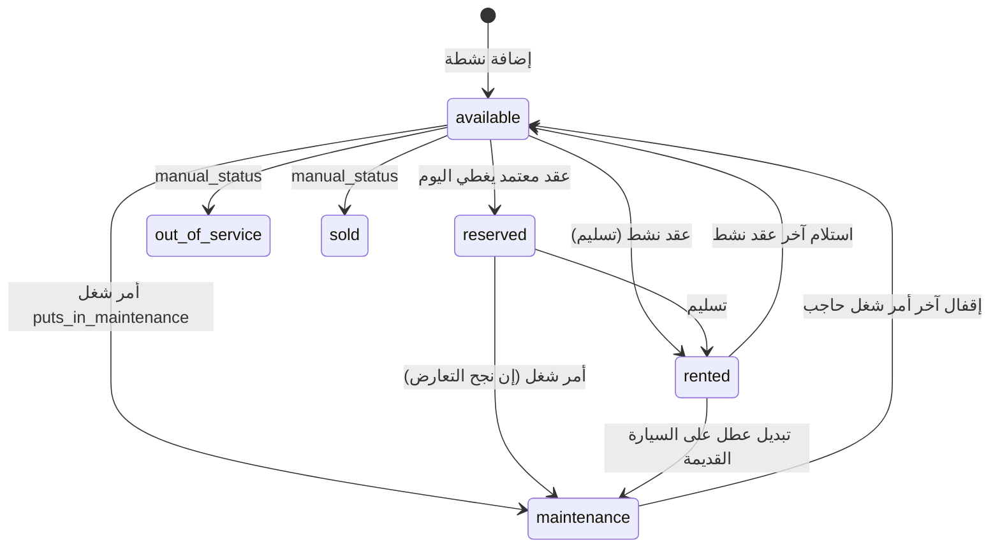
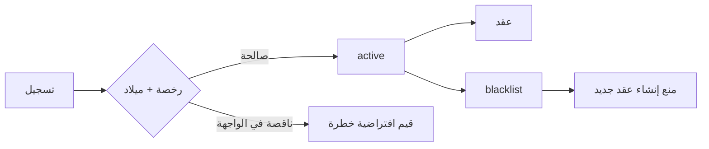
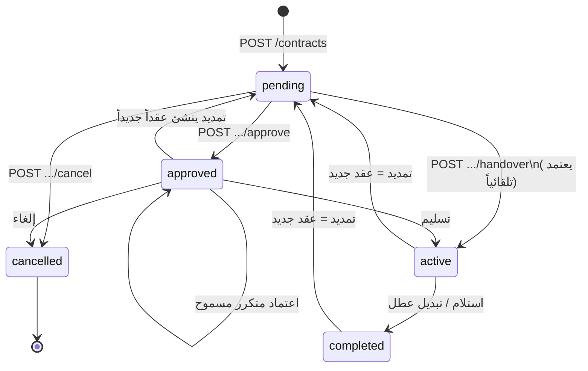
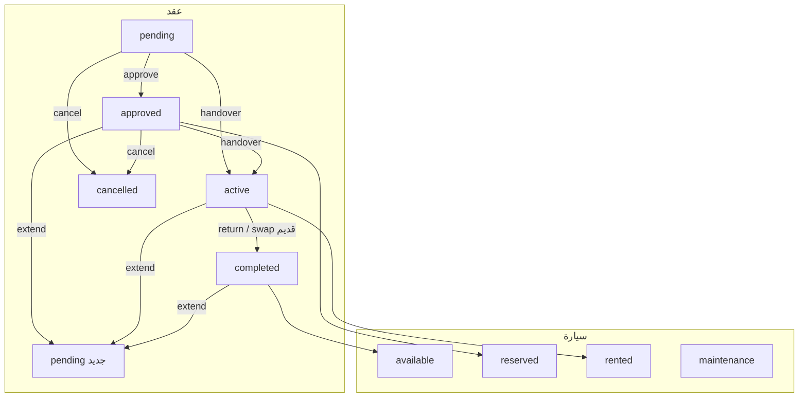

# سيناريو العمل الكامل — نظام آر بي إم لإدارة التأجير

| البند | القيمة |
|--------|--------|
| الحالة | وثيقة تشغيل مطابقة للكود الحالي + فجوات معروضة للموافقة |
| التاريخ | ٢٩ أكتوبر ٢٠٢٦ |
| المصدر | الكود الحي في `backend/` و`ui-pwa/` ومعايير المشروع ٢٫٤٫٩ و`docs/RSD.md` ٣٫٤ |
| الإصلاحات | **غير مطبَّقة** حتى موافقة صريحة — تُوسم أدناه بـ «مقترح» |

هذه الوثيقة تصف دورة العمل كما ينفّذها الكود اليوم. كل قاعدة معلَّمة **مقترح** هي ما يجب أن يصبح عليه النظام بعد الموافقة على جدول التدقيق.

لا يوجد حجز منفصل عن العقد: كيان التشغيل هو **`contracts`**. لا Filament ولا Livewire ولا Blade لشاشات التشغيل — الواجهة React SPA والباك Laravel API + Service.

---

## ١) نظرة عامة على النظام والأدوار

### ١٫١ الطبقات
```
موظف المعرض (PWA عربي RTL)
        ↕ JSON / Sanctum
Laravel: Controller رفيع → FormRequest (ناقص) → Service → MySQL InnoDB
        ↕
صلاحيات مفاتيح نصية (لا Policy classes) · إشعارات داخلية · محادثة محدودة · كرون غير مفعّل
```

### ١٫٢ الأدوار كما في الكتالوج (`PermissionCatalog`)
| الدور العملي | مفاتيح صلاحية نموذجية | ماذا يفعل |
|--------------|------------------------|-----------|
| مدير النظام / المُدمج | كل المفاتيح + `is_integrator` | إعدادات، فروع/فيتشر فلاج، مستخدمون |
| موظف استقبال | `contracts.*` · `customers.*` · `vehicles.view` | إنشاء عقد، اعتماد إن مُنح، تسليم/استلام |
| محاسب | `accounting.*` · `payments.*` · `deposits.*` · `expenses.*` | قبض، رد، إقفال شهر، مصروف |
| فني صيانة | `maintenance.*` · `inventory.*` | أمر شغل، صرف FIFO |
| موارد بشرية | `hr.*` | موظفين، تقييم، مسير، سلف |
| معرِض | `showroom.run` | وضع عرض بدون تعديل |

**واقع الكود:** التنقّل يخفي الأقسام حسب `can()` في `AppShell.tsx`، أما أزرار العقد (اعتماد/تسليم/إلغاء/تمديد) **لا تُخفى** حسب الصلاحية — الرفض يحدث `403` من الـ API فقط. **مقترح:** إخفاء/تعطيل كل زر دورة عقد وفق المفتاح نفسه في `routes/api.php` (سطر ١١٤–١٢٢).

### ١٫٣ حالات العقد الرسمية (ن٫٨)
`pending` معلّق → `approved` معتمد → `active` نشط (بعد التسليم) → `completed` مكتمل أو `cancelled` ملغى.

لا توجد حالة `draft` منفصلة. الإنشاء يضع `pending` افتراضياً.

---

## ٢) دورة حياة السيارة



الحالة المعروضة **مشتقّة** وليست عموداً مخزَّناً (`VehicleAvailabilityService::statusOnDate` سطر ٣٢–٥٤، و`VehicleController::present` سطر ٣٩٤–٤٠٣):

1. `manual_status` إن كان `maintenance` / `out_of_service` / `sold`
2. وإلا صيانة إن وُجد حاجز أمر شغل — **لكن** العرض يمرّر `open_work_order_blocks = (manual_status === 'maintenance')` فيسقط فحص أوامر الشغل الفعلية
3. وإلا `rented` إن وُجد عقد `active`
4. وإلا `reserved` إن وُجد عقد `approved` يغطي `now()`
5. وإلا `available`

### انتقالات مسموحة / ممنوعة اليوم
| الانتقال | مسموح؟ | أين |
|----------|---------|-----|
| حجز سيارة `is_active = false` | ممنوع | `ContractLifecycleService.php:35–37` |
| حجز سيارة `manual_status = maintenance` | ممنوع | سطر ٣٨–٤٠ |
| حجز سيارة `sold` / `out_of_service` | **مسموح حالياً** | لا فحص — **مقترح: رفض** |
| حجز سيارة عليها عقد `pending/approved/active` متداخل | ممنوع عند الإنشاء/الاعتماد | `assertNoOverlap` سطر ٥٠١–٥١٦ |
| تسليم عقد ثانٍ على نفس السيارة بينما الأول `active` | **ممكن إن لم يُفحص التداخل عند التسليم** | `activateOnHandover` سطر ١٣١–١٧٤ بلا `assertNoOverlap` — **مقترح: إعادة الفحص** |
| أمر شغل يضع السيارة في صيانة مع عقد `active` | **مسموح** | `WorkOrderService.php:31–33` يفحص `pending/approved` فقط — **مقترح: إدراج `active`** |
| تبديل عطل | يغلق القديمة ويكملها ويضع `manual_status = maintenance` | `swapDueToFault` سطر ٣٦٦–٣٦٨ |

حقول التتبع على السيارة فقط: `tracker_device_number` · `tracker_sim_number`. بلا جهاز GPS مستقل وبلا تنبيه انقطاع — مطابق لن٫١ (تتبع حقليْن بلا خريطة). **مقترح لاحق ضمن النطاق:** تنبيه داخلي إذا بقي الحقل فارغاً على سيارة مؤجرة، لا خريطة حيّة.

---

## ٣) دورة العميل



### ٣٫١ التسجيل
إلزامي في API: الاسم، الهاتف، تاريخ الميلاد، رقم الرخصة، انتهاء الرخصة (`CustomerController.php:40–52`). الرقم القومي **اختياري**. صور الهوية/الرخصة مسارات اختيارية.

**فجوة واجهة:** إنشاء عميل مضمَّن من شيت العقد يرسل `birth_date: 1990-01-01` و`license_expires_on: 2030-01-01` بلا حقول ظاهرة (`NewContract.tsx:15, 61–65`). **مقترح:** إظهار الحقول وإزالة الافتراضات الصامتة.

### ٣٫٢ الحظر
`status ∈ {active, blacklist}` عند التحديث. الإنشاء يرفض `blacklist` و`blacklisted` (`ContractLifecycleService.php:43–45`). الاعتماد **لا يعيد** فحص القائمة السوداء. **مقترح:** إعادة الفحص عند الاعتماد والتسليم.

### ٣٫٣ تجديد الرخصة
عند الاعتماد: إن `block_expired_license` (افتراضي نعم) والرخصة في الماضي → رفض. وإن انتهاء الرخصة قبل `planned_ends_at` → رفض دائماً (سطر ٥٢٧–٥٣٣). لا كرون لتذكير قرب الانتهاء. **مقترح:** إشعار يومي للمدير عند بقاء ≤ ٣٠ يوماً.

---

## ٤) دورة الحجز والعقد خطوة بخطوة



### ٤٫١ إنشاء
`POST /api/contracts` عبر `StoreContractRequest`: `planned_ends_at` بعد `starts_at`، مبالغ ≥ 0. الخدمة تفحص السيارة النشطة/الصيانة، القائمة السوداء، التداخل.

يثبَّت عند **الإنشاء** لا الاعتماد: السعر اليومي، بدل الكم، سعر الزيادة، الوديعة، رسوم التشغيل (`ContractLifecycleService.php:64–68`). هذا **يخالف ن٫٥** («عند الاعتماد تُثبَّت»). رسالة الـ API بعد الاعتماد تقول «تم اعتماد العقد وتثبيت الأسعار» (`ContractController.php:79`) بينما الاعتماد يحدّث `approved_days` و`allowed_km` فقط (سطر ١٠٧–١١٥).

**مقترح:** نقل التثبيت إلى `approve()` كما في ن٫٥، مع إبقاء المسودّة قابلة لتعديل السعر قبل الاعتماد.

حقول RSD غير ظاهرة في شيت الإنشاء: كفيل، بدل كم، سعر زيادة، خصم، رسوم أخرى، تأمين تشغيل، موظف مبيعات (يُملأ صامتاً من المستخدم الحالي).

### ٤٫٢ تأكيد / اعتماد
صلاحية `contracts.approve`. فحوصات المستندات + التداخل. الواجهة تعرض الزر لكل `pending` بلا `can('contracts.approve')`.

### ٤٫٣ دفع العربون (التأمين النقدي)
وديعة نقدية **خارج** إجمالي العقد (ن٫٤). `POST .../deposit` مرة واحدة. يُسجَّل `payments` اتجاه `in` و`link_type=deposit`. لا يُمنع التسليم إن لم تُقبض الوديعة. **مقترح تشغيلي (للموافقة):** جعل القبض إلزامياً قبل التسليم بإعداد `require_deposit_before_handover`.

### ٤٫٤ تمديد (ن٫١٨)
عقد **جديد** `pending` يبدأ عند نهاية المصدر ما لم يُمرَّر `starts_at`. المصدر لا يُغلق. overlap يُفحص داخل `create` فقط.

`extend()` **لا يمرّ** على `StoreContractRequest` — يمكن إرسال `planned_ends_at` قبل البداية. **مقترح:** FormRequest للتمديد: النهاية بعد البداية وبعد نهاية المصدر؛ منع تسليم التمديد قبل إغلاق المصدر أو جعل النافذة غير متداخلة بصرامة.

### ٤٫٥ إلغاء (ن٫٩)
قبل التسليم فقط (`pending`/`approved`). سبب ≥ ٣ أحرف في الكنترولر (سطر ١٦٨–١٧٠) بينما الخدمة تقبل أي نص غير فارغ (سطر ٢٧١–٢٧٣). يرد الوديعة إن حالتها `received` فقط — لا `partial`. يرد كل دفعات `link_type=contract` الواردة بحركات `out`. بعد التسليم الرسالة تقول «إنهاء مبكر أو استلام» **ولا يوجد مسار إنهاء مبكر منفصل** — الاستلام هو الإنهاء ويعتمد الحد الأدنى للأيام (ن٫٦ عبر `frozen_min_days`).

**مقترح:** مسار `early-close` واضح في الواجهة = نفس `completeOnReturn` مع تاريخ فعلي، ووسم «إنهاء مبكر» في السجل.

### ٤٫٦ استرجاع / حذف
`SoftDeletes` على العقد بلا API استعادة. لا تحديث تواريخ بعد الإنشاء إلا بعقد جديد.

---

## ٥) استلام السيارة (التسليم للعميل — handover)

المطلوب في الخدمة: عداد ≥ عداد السيارة، توقيع إن `require_handover_signature` (افتراضي نعم)، نوع فحص `handover`. الوقود افتراضي **٥٠** إن غاب. المستلزمات والأضرار اختيارية في الـ API وغير موجودة في شيت الواجهة.

| حقل | API | الواجهة اليوم | مقترح |
|-----|-----|----------------|--------|
| عداد الخروج | إلزامي | حقل رقم | فحص ≥ عداد المركبة قبل الإرسال |
| وقود | 0–100 | نسبة مئوية | مطابقة RSD: مستويات ١–٨ معلوماتية بلا قيد محاسبي |
| توقيع | خدمة | لوحة إلزامية دائماً | قراءة إعداد المستأجر |
| مستلزمات | مدعومة | غير مرسلة | قائمة من `vehicle_accessories` |
| أضرار قائمة | مدعومة | غير مرسلة عند التسليم | نموذج أضرار قائمة |
| صور فحص الجوانب | غير مُلزَمة | غير موجودة | إلزام صور عند الإعداد |
| المعاين / الوقت | `inspector_id` + `inspected_at=now()` | غير ظاهر | عرض في التفاصيل والطباعة |

التسليم من `pending` يعتمد تلقائياً ثم يفعّل (`activateOnHandover` سطر ١٣٧–١٤٠). التسليم مرة ثانية على نفس العقد مرفوض لأن الحالة لم تعد `approved/pending`. لا قيد uniqueness على `(contract_id, type)` فيجدول الفحوصات — يمكن إنشاء صفوف فحص إضافية عبر الخدمة إن استُدعيت خارج الحارس.

**مقترح:** قيد فريد `(contract_id, type)` + إعادة `assertNoOverlap` عند التسليم + منع تسليم سيارة `sold/out_of_service`.

---

## ٦) تسليم / إرجاع السيارة (الاستلام من العميل — return)

يشترط عقداً `active` وعداد عودة ≥ عداد الخروج. لا يُسمح بالإرجاع دون تسليم.

عند الإقفال (`completeOnReturn` سطر ٢٠٦–٢٤٤):
- أيام الإيجار = من `starts_at` حتى `returned_at` أو الآن (ن٫٢)
- أيام التأخير = إن تجاوز `planned_ends_at` تُوسم `tagged_late_days` **ولا تُضاف غرامة منفصلة** (ن٫٣)
- `billableDays = max(أيام فعلية, الحد الأدنى)`
- الإيجار = billableDays × السعر المجمَّد
- الكم المسموح = البدل اليومي × **billableDays** (فيزيد مع التأخير والحد الأدنى)
- الزيادة = (المقطوع − المسموح) × سعر الزيادة
- الإجمالي = إيجار − خصم + زيادة كم + أضرار + تأمين تشغيل + رسوم أخرى (الوديعة خارجاً)
- ترحيل محاسبي `postContractClose`

**مقترح:** حساب الكم المسموح على `approved_days` الأصلي (أو أيام مخطط) لا على أيام التأخير، إن وُافق العمل أن التأخير لا يمنح كيلومترات إضافية — هذا تعارض محتمل مع حرفية ن٫٢ «× أيام الإغلاق» ويحتاج قراركم.

إرجاع مبكر: يحترم الحد الأدنى. تأخير: أيام موسومة. تمديد: عقد جديد لأيام الجديد فقط.

الضرر: `damage_fee` يدخل الإجمالي والحسابات (حساب ٤٢٠٠) **ولا** يفتح أمر شغل تلقائياً. **مقترح:** خيار «فتح أمر شغل من أضرار الاستلام».

الواجهة لا ترسل `returned_at` ولا قائمة مستلزمات. صورة الضرر تُرفع عبر `/media` ثم تُرسل `photo_path` — لكن قواعد الكنترولر **لا تتضمن** `damages.*.photo_path` (`ContractController.php:127–129`) فيُحذف الحقل من المصفوفة المعتمدة. **مقترح:** إضافة القاعدة وربط `media_files`.

---

## ٧) المرفقات المطلوبة في كل مرحلة

| المرحلة | الموجود | الإلزام في الكود | مقترح |
|---------|---------|-------------------|--------|
| عميل | مسار صورة بطاقة/رخصة + `media_files` | غير إلزامي قبل الاعتماد | إلزام صورة رخصة قبل الاعتماد إن فُعّل الإعداد |
| سيارة | `vehicle_documents` (نوع/انتهاء/ملف) | يمنع الاعتماد إن انتهت و`block_expired_vehicle_docs` | الإبقاء |
| عقد | `media_files` مورف | غير إلزامي | نسخة عقد موقَّعة عند الاعتماد |
| تسليم/استلام | توقيع مخزَّن محلياً، ضرر `photo_path` | توقيع حسب الإعداد | صور فحص + ضرر مربوطة |
| صيانة | `invoice_path` على أمر الشغل | غير إلزامي | — |
| GPS | لا مرفقات | — | خارج النطاق الحي |

الرفع: صور ≤ ٥ ميجا، فيديو ≤ ٥٠، أنواع محددة (`MediaUploadService.php:13–19, 32–38`). الحذف يمسح الملف ثم soft-delete للسجل. حذف العقد **لا** ينظف `media_files` المورفية (لا cascade). **مقترح:** تنظيف عند force-delete / أمر صيانة.

---

## ٨) المحاسبة (القيود الناتجة عن كل عملية)

| العملية | قيد / حركة اليوم | ملاحظات |
|---------|-------------------|---------|
| قبض وديعة | `payments` in / deposit | بلا قيد يومية في الدليل |
| رد وديعة | `payments` out | إن المتبقي > 0 |
| خصم وديعة | صف `deposit_deductions` فقط | **بلا يومية** — **مقترح:** قيد من الالتزام إلى إيراد/أضرار |
| استلام عقد | يومية `contract_close:{id}`: ذمم ١٢٠٠ مقابل إيجار ٤٠٠٠ (موزع على الشهور) + زيادة ٤١٠٠ + أضرار ٤٢٠٠ + رسوم ٤٣٠٠ − خصم عكس الإيجار | يتطلب شهراً مفتوحاً |
| قبض إيجار نقدي | يدوي `POST /accounting/payments` `link_type=contract` | غير تلقائي عند الإقفال |
| إلغاء قبل التسليم | رد وديعة + رد دفعات العقد | لا يومية إقفال |
| مصروف تشغيلي | يومية مصروف ٥١٠٠ / نقدية ١٠٠٠ + خصم عهدة إن لزم | `ExpenseService.php:29–78` |
| مخالفة | متابعة فقط | بلا ترحيل (ن٫١١) |
| مسير رواتب | سلف + صرف جزئي | خارج يومية العقد |
| مالك | `owner_month_dues` / `owner_payouts` | اختياري يومية |

لا رصيد دائن للعميل (ن٫١). الزيادة عند إنهاء مبكر تُرد بحركة «مدفوع للعميل» عند الإلغاء قبل التسليم فقط؛ بعد التسليم الفرق يبقى في ذمة الإقفال حتى يُقبض/يُرد يدوياً.

**مقترح:** منع إقفال عقد على شهر مقفل برسالة أوضح في الواجهة؛ منع تكرار `source = contract_close:{id}` بقيد فريد.

---

## ٩) الصيانة وربطها بحالة السيارة

أمر شغل مفتوح يضع `manual_status = maintenance` إن `puts_in_maintenance`. التعارض يُرفض إن وُجدت عقود `pending/approved` مستقبلية ما لم `force_after_resolution`. العقد **النشط** لا يُعد تعارضاً — يمكن وضع سيارة مؤجَّرة في صيانة صامتة (يخالف ن٫١٣).

تبديل العطل يكمل العقد القديم ويضع السيارة القديمة في صيانة بلا أمر شغل. **مقترح:** إنشاء أمر شغل تلقائي من التبديل.

إقفال الأمر يصفّر `manual_status` إن لم يبقَ أمر حاجب.

صرف القطع: FIFO من الدفعات (`WorkOrderService.php:72–96`).

---

## ١٠) أجهزة GPS والتنبيهات

النطاق الملزم: رقم جهاز + رقم شريحة على بطاقة السيارة فقط. لا جدول أجهزة، لا حالة أونلاين، لا كرون، لا تنبيه انقطاع. الحقول موجودة في النموذج والواجهة (ملف المركبة) لكنها لا تشارك في أي قاعدة دورة عقد.

**مقترح ضمن النطاق:** إن كانت السيارة `rented` والجهازان فارغان → إشعار داخلي لمدير الأسطول (ليس تتبعاً حياً).

---

## ١١) الإشعارات (متى ولمن)

`NotificationDispatchService::notify` يسجّل صفاً وWeb Push إن وُجد VAPID. **الاستدعاءات في التشغيل: لا شيء** — فقط `DemoSeeder` واختبار الدفع.

لا أوامر جدول في `routes/console.php` سوى `inspire`.

| الحدث المتوقع | اليوم | مقترح |
|---------------|--------|--------|
| قرب نهاية عقد | لا | Cron يومي → مستخدم `sales_user_id` + صلاحية عقود |
| تأخير إرجاع | لا | عند تجاوز `planned_ends_at` وعقد `active` |
| صيانة مفتوحة تجاوزت ن يوماً | لا | — |
| رخصة ≤ ٣٠ يوماً | لا | — |
| GPS فارغ على مؤجَّرة | لا | — |
| مسير معتمد | لا | إلى HR |

الواجهة تعرض السجل الزمني إن وُجدت صفوف، مع اختصار `link_type` (`NotificationsPage.tsx:20–27`).

---

## ١٢) قواعد التحقق الكاملة لكل مرحلة

| المرحلة | قاعدة الخادم اليوم | قاعدة العميل اليوم | قاعدة DB | مقترح |
|---------|---------------------|---------------------|----------|--------|
| إنشاء عقد | `after:starts_at` · exists · min:0 · تداخل · سيارة نشطة · ليست صيانة · ليست قائمة سوداء | لا فحص تواريخ قبل الإرسال | لا قيد تداخل | مطابقة العميل + رفض sold/OOS + FormRequest لرسوم التشغيل |
| اعتماد | حالة pending/approved · رخصة · تداخل | زر ظاهر دائماً | — | `can('contracts.approve')` + إعادة فحص الحظر |
| تسليم | حالة · عداد · توقيع خدمة | توقيع UI دائماً · لا عداد | لا unique فحص | overlap + unique (contract,type) |
| استلام | active · عداد ≥ خروج · توقيع مشروط | أضرار تتطلب حقلين معاً | — | `photo_path` في القواعد · returned_at · مستلزمات |
| إلغاء | pending/approved · سبب | textarea required بلا min:3 | — | توحيد min:3 · رد وديعة partial |
| تمديد | حالة المصدر · create بلا FormRequest | تاريخ+وقت فقط | — | FormRequest: نهاية بعد بداية المصدر |
| تبديل | active · سيارة بديلة | بلا توقيع/سبب عطل | — | تمرير فحص للتسليم الجديد · planned_ends > now |
| وديعة | مرة واحدة · مبلغ > 0 | لا حد | — | إخفاء خصم/رد إن `settled` |
| خصم وديعة | ≤ المتبقي | لا | — | حد المتبقي في الحقل |
| عميل | رخصة+ميلاد | شيت مضمَّن يخفي التواريخ | رخصة NOT NULL | إزالة الافتراضات |
| مبلغ | min:0 لا يمنع خصم > إيجار | لا | — | `discount ≤ period_rent` عند الإقفال |
| صلاحيات | middleware مفاتيح | شريط فقط | — | أزرار الدورة |

رسائل ٤٢٢ عربية في الخدمة. الشيتات عدا «عقد جديد» تعرض التوست لا أخطاء الحقل.

---

## ١٣) حالات خاصة

### تأخير
أيام إضافية موسومة، بلا غرامة منفصلة. الكم المسموح اليوم يتضخم مع أيام التأخير.

### حادث / أضرار
`damage_fee` + وصف اختياري. لا مطالبة تأمين، لا أمر شغل تلقائي، لا خصم وديعة تلقائي.

### سرقة
غير ممثَّلة. **مقترح:** حالة مركبة `out_of_service` يدوية + إغلاق عقد بالاستلام مع أضرار/ملاحظات.

### استبدال سيارة (ن٫١٧)
`swapDueToFault`: إكمال القديمة الآن، صيانة القديمة، عقد جديد `approved` ثم تسليم بلا payload فحص (`swapDueToFault` سطر ٣٩٠–٣٩١) — يفشل إن كان التوقيع إلزامياً، أو يُسلَّم بوقود افتراضي ٥٠ بلا مستلزمات. ترحيل متبقي الوديعة كقبض `transfer` على الجديد. **مقترح:** تمرير توقيع/عداد/مستلزمات للتسليم الجديد، ومنع نهاية مخطط في الماضي (عقد متأخر).

### دفع جزئي
دفعات يدوية على `payments`. لا يمنع الإقفال إن لم يُحصَّل النهائي. الذمة تظهر في ملف العقد (`ContractDossierService`). مسير الرواتب يدعم صرفاً جزئياً وترحيل المتبقي (ن٫٢٣) — منفصل عن العقود.

---

## ملحق أ — آلة الحالات كما في الكود



---

## ملحق ب — جدول الفجوات المعروضة للموافقة (ملخص)

يُنفَّذ الإصلاح فقط بعد الموافقة. التفاصيل مع المسارات وأرقام الأسطر في تقرير التدقيق المرفق في المحادثة.

| أولوية | الموضوع |
|--------|---------|
| Critical | منع عقدين `active` على سيارة: overlap عند التسليم + صيانة لا تتجاهل `active` + رفض sold/OOS |
| Critical | تمديد/تبديل يتجاوزان FormRequest (نهاية قبل بداية / نهاية في الماضي) |
| Critical | مسار الإنهاء المبكر غير موجود رغم رسالة الإلغاء |
| High | تثبيت الأسعار عند الاعتماد لا الإنشاء (ن٫٥) |
| High | `photo_path` للأضرار يُحذف في الكنترولر |
| High | إشعارات الأحداث غير مربوطة بأي Service تشغيلي ولا كرون |
| High | أزرار الدورة بلا `can()` · تبديل بلا فحص كامل · وديعة `settled` ما زالت قابلة للخصم في الواجهة |
| Medium | وقود ٠–١٠٠ مقابل مستويات ١–٨ · مستلزمات غير ظاهرة · تسميات timeline/inspection · فروع بلا نموذج · كم مسموح مع التأخير |
| Low | تقويم بلا رابط للعقد · methods إنجليزية في دفتر الدفعات · تنظيف media عند الحذف |

---

*نهاية سيناريو العمل — يُحدَّث في نفس التغيير الذي يطبّق الإصلاحات المعتمدة.*
